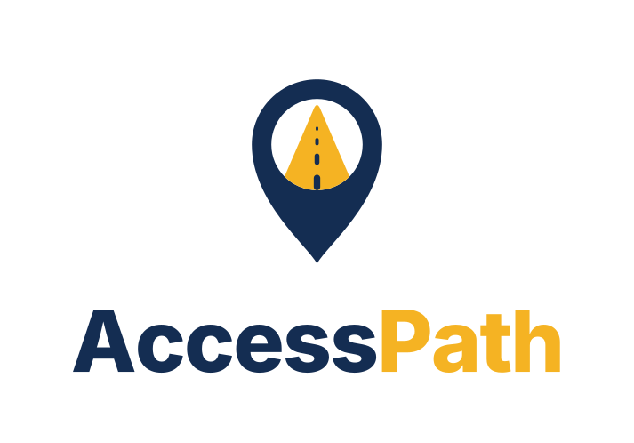
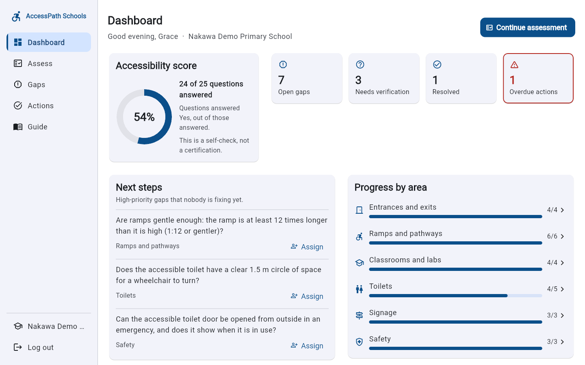
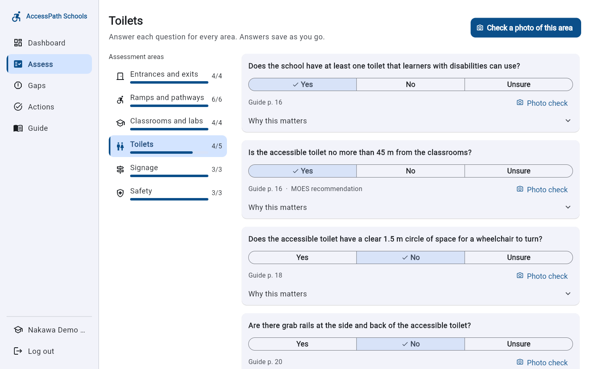
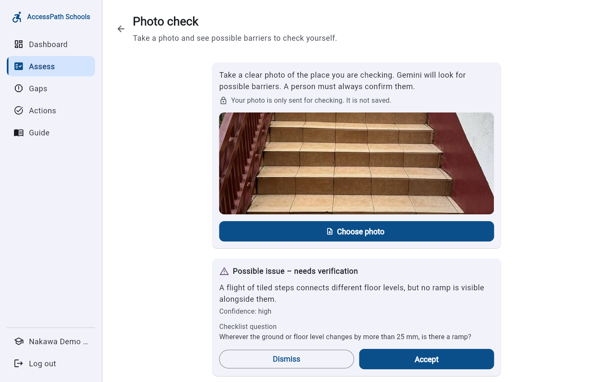
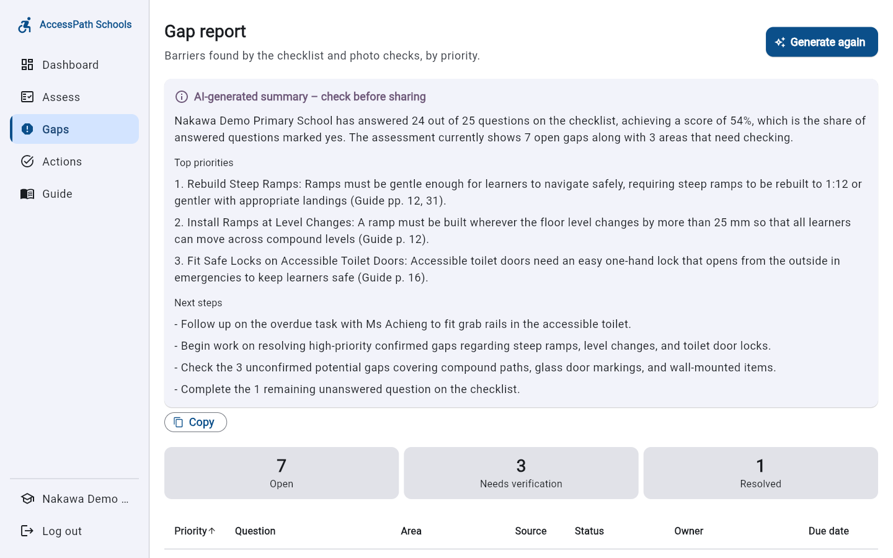
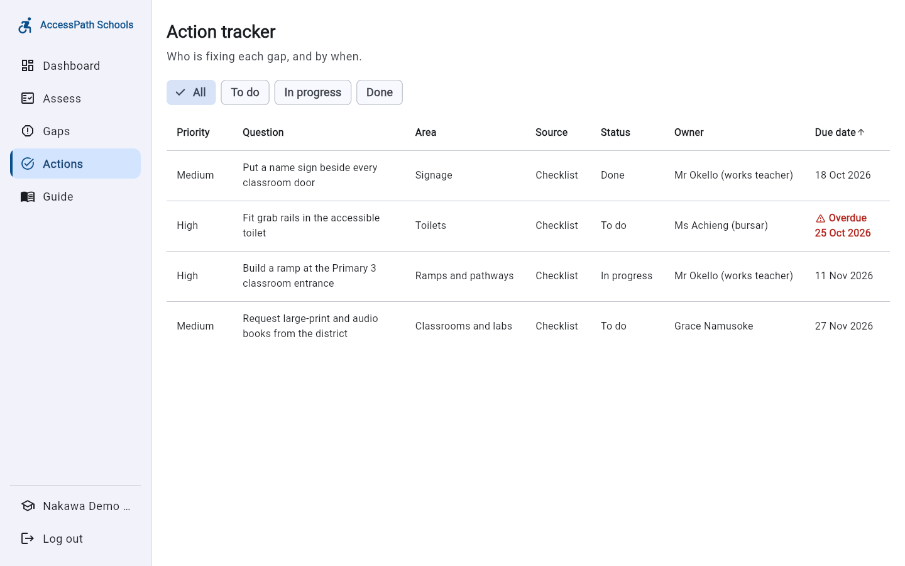
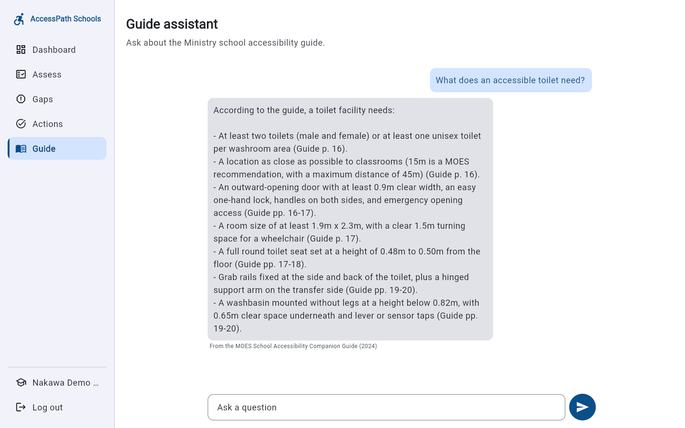
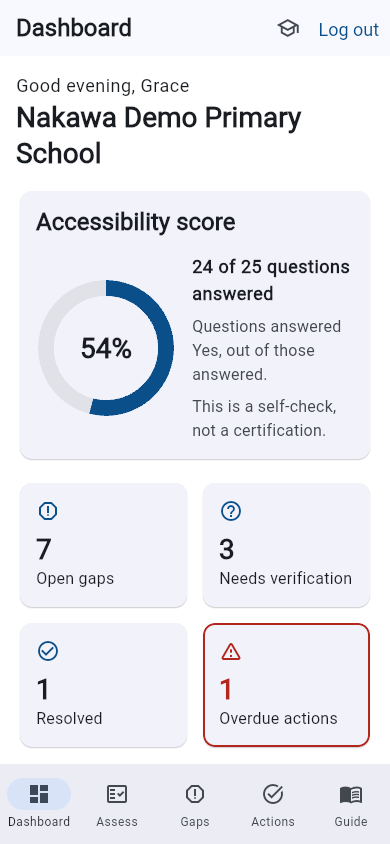
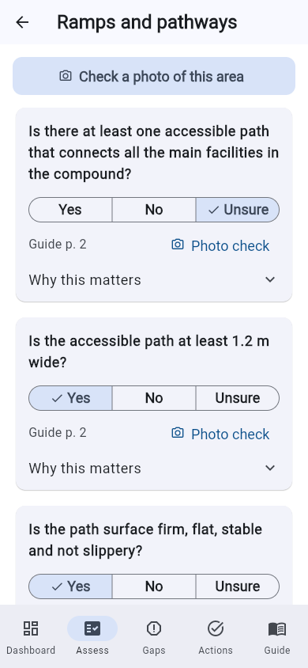

<p align="center">
  
</p>

# AccessPath Schools

A Flutter app that helps Ugandan schools check their buildings against the Ministry of
Education and Sports' accessibility guidance, see what is missing, and track the fixes.

**Know what's missing. Understand what is required. Improve what matters.**

Built for SDG 4 (Quality Education) and SDG 10 (Reduced Inequalities).

## The problem

Schools may believe they are inclusive without knowing whether their buildings let
learners with disabilities move, learn and use facilities independently. The Ministry's
School Accessibility Companion Guide (2024) names inaccessible infrastructure and limited
awareness of accessibility standards as major barriers for these learners. The guidance
exists, but schools have no simple way to check their own buildings against it, decide
what to fix first, and follow the fixes through.

## What it does

- **Guided checklist:** 25 questions across six areas (entrances, ramps and pathways,
  classrooms, toilets, signage, safety), taken from the MOES School Accessibility Companion
  Guide, each with the guide page it comes from
- **Photo check:** take a photo and Gemini lists possible barriers for the school to verify
- **Gap report:** every barrier found, by priority, with a recommendation from the guide
- **Action tracker:** who is fixing each gap, by when, and whether it is done
- **Dashboard:** accessibility score, open gaps, items to verify and overdue actions
- **Guide assistant:** ask questions about the guide and get answers with page references
- **AI report summary:** a short summary of the school's results and next steps

## Screenshots

| Dashboard | Checklist |
|---|---|
|  |  |

| Photo check | Gap report with AI summary |
|---|---|
|  |  |

| Action tracker | Guide assistant |
|---|---|
|  |  |

On a phone:

 

The screenshots use a demo school with sample data. The photo check uses a real photo of
steps on our campus.

## Try it

- **Web:** https://gen-lang-client-0366595329.web.app
- **Android:** download the APK from the [latest release](https://github.com/Nshuti7/accesspath-schools/releases/latest)

## Built with

- Flutter (web and Android)
- Firebase Authentication
- Cloud Firestore
- Firebase AI Logic with the Gemini Developer API
- Firebase Hosting

## Responsible AI

- The checklist comes from the official Ministry guide, with page references. AI does not
  invent checklist items.
- Every AI finding is labelled "Possible issue – needs verification" for a person to check.
- The app never says a school is compliant or certified.
- Photos are sent for checking and never stored.
- No learner data is collected; only staff names and emails.

## Run it locally

You need the Flutter SDK (stable channel).

```bash
flutter pub get
flutter run -d chrome
```

## Team: Ctrl Freaks

| Name | Role |
|---|---|
| Brice Nshuti | Lead developer and release |
| Hussaina Dhrolia | Documentation, pitch deck and demo video |
| Jalia Nyirasenga | Code review, Android build and phone testing |
| Umar Faruq-Salihu | Testing: accounts, checklist and photo check |
| Shamil Baker | Testing: gaps, actions, dashboard and AI features |

See [CONTRIBUTING.md](CONTRIBUTING.md) for how we worked.

## How we built it

Developed with help from Claude Code; tasks managed in YouTrack.

## Source

Ministry of Education and Sports, Uganda: *School Accessibility Companion Guide*
(launched July 2024).
